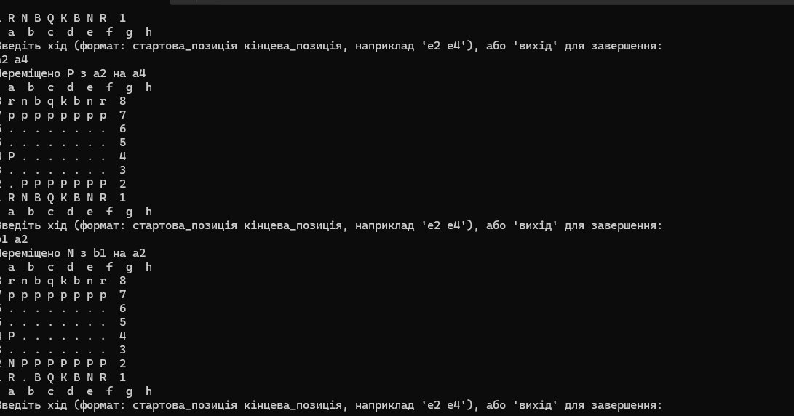
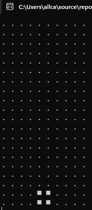

# Console Chess & Tetris (C#)

Two small console games written in C# / .NET 8.

## Chess



A two-player chess board in the terminal.

- Standard starting position, board drawn in ASCII (uppercase = White, lowercase = Black)
- Moves entered in coordinate notation, e.g. `e2 e4`
- Turns alternate between White and Black
- Basic validation: you can only move your own pieces and can't capture your own piece

Not implemented yet: movement rules for each piece type, check/checkmate, castling, en passant, promotion.

```bash
dotnet run --project chess/chess
```

## Tetris



A minimal falling-blocks game in the terminal.

- Three shapes: square, T-shape and line
- Full rows are cleared and scored (100 points per row)
- Controls: `←` / `→` move, `↓` drop faster, `Q` quit

```bash
dotnet run --project Tetris/Tetris
```

## Requirements

[.NET 8 SDK](https://dotnet.microsoft.com/download)
